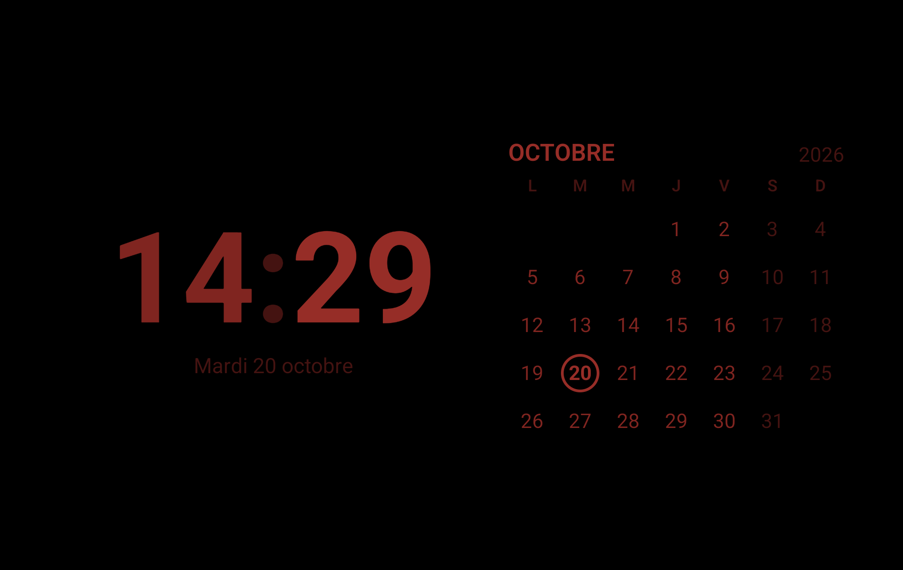
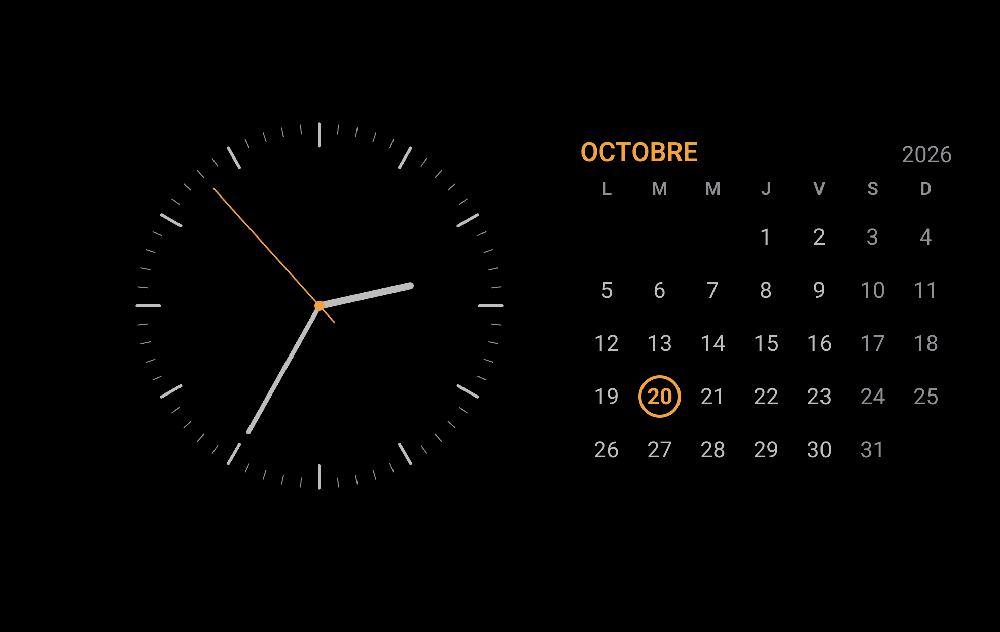
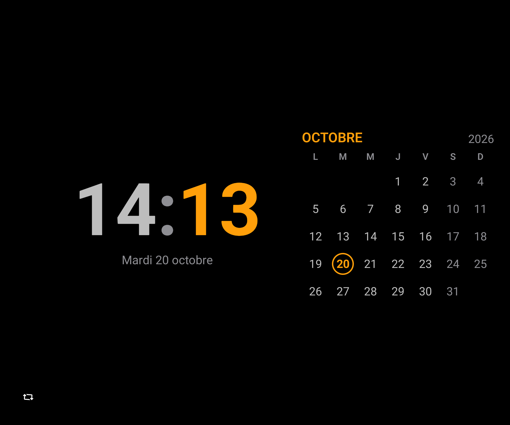
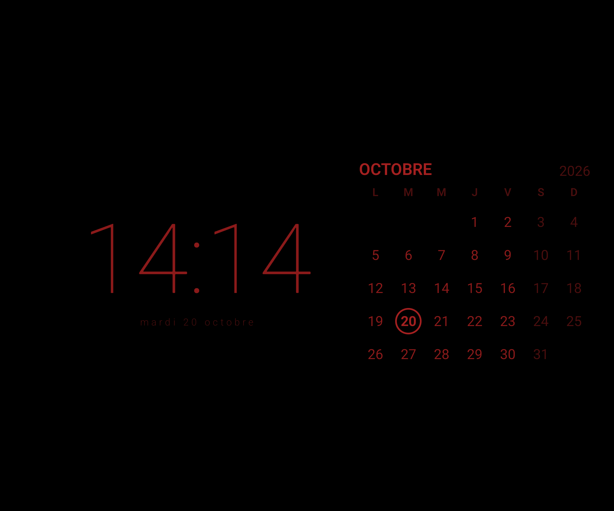
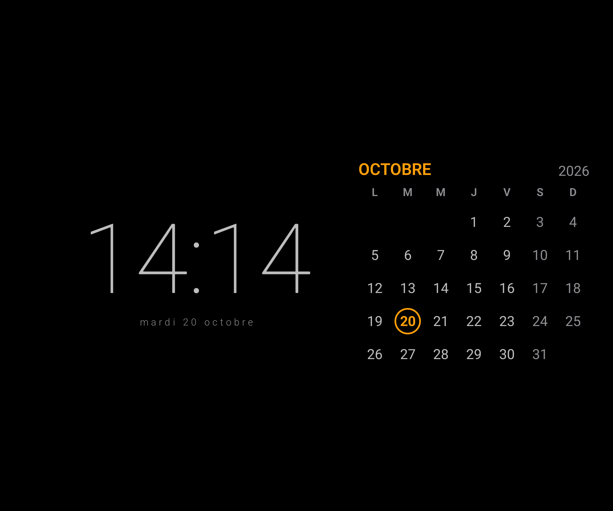
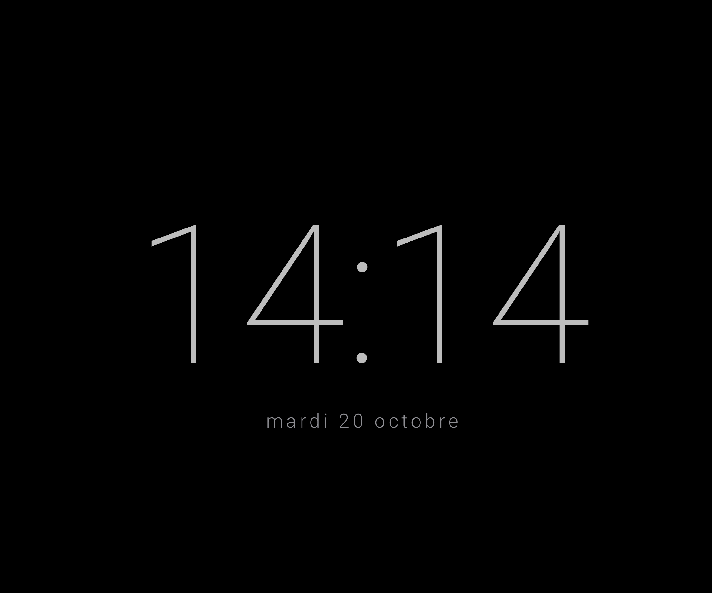
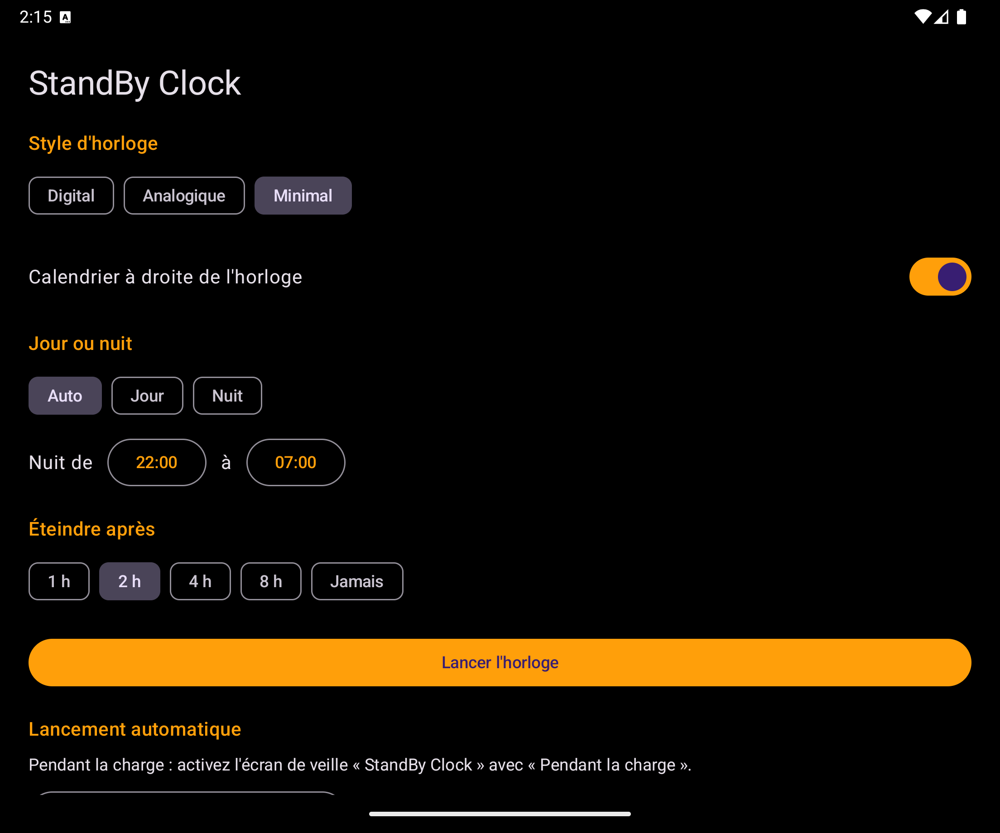

# AlwaysClock

[](https://github.com/clement-vassant/AlwaysClock/actions/workflows/build.yml)

**Le mode StandBy de l'iPhone sur Android : une grande horloge en paysage pendant que le téléphone charge.**

Fonctionne sur tout téléphone Android 10 ou plus récent. Testée sur un Galaxy Z Fold, sur ses deux écrans : l'écran extérieur, téléphone plié, et le grand écran déplié.

| Écran extérieur du Fold, mode nuit | Écran extérieur du Fold, analogique |
|---|---|
|  |  |
| **Grand écran, Digital** | **Grand écran, Minimal en mode nuit** |
|  |  |

## Pourquoi

Samsung ne laisse aucune app tierce dessiner sur l'Always On Display. AlwaysClock passe donc par deux autres moyens :

- **l'écran de veille Android**, qui se lance tout seul quand le téléphone charge ;
- **une app plein écran**, à ouvrir soi-même : le téléphone passe en paysage et l'écran reste allumé.

## Fonctionnalités

- **Trois styles d'horloge** : Digital (grands chiffres), Analogique (cadran à aiguilles) et Minimal (chiffres fins). Le choix est mémorisé.
- **Calendrier du mois** à côté de l'horloge, avec le jour courant entouré. Un appui long l'affiche ou le masque.
- **Jour ou nuit rouge** : en *Auto*, la nuit suit une plage horaire (22:00 → 07:00 par défaut) ; on peut aussi forcer *Jour* ou *Nuit*. Le mode nuit passe en rouge sombre à luminosité minimale pour préserver la vision nocturne.
- **Gestes** :
  - balayer à gauche ou à droite pour changer de style ;
  - toucher pour inverser jour et nuit jusqu'à la prochaine bascule programmée ;
  - appui long pour afficher ou masquer le calendrier ;
  - double toucher pour ouvrir les réglages.
- **Lancement pendant la charge** grâce à l'écran de veille Android.
- **Entrées « Horloge jour » et « Horloge nuit »** pour lancer l'horloge dans un mode donné depuis *Modes et routines* (Samsung) ou depuis tout autre outil d'automatisation capable d'ouvrir une app (Tasker, par exemple), à heure fixe ou au début d'un mode.
- **Réglages** : style, calendrier, jour/nuit et plage de nuit, délai d'extinction.
- **Protection de l'écran OLED** : le contenu suit une orbite lente, l'horloge et le calendrier échangent leur place chaque heure, la luminosité est limitée et l'horloge s'arrête toute seule après 2 h par défaut. Détails dans [Protection de l'écran](#protection-de-lécran).

Pas de publicité, pas de réseau, aucune permission demandée.

<details>
<summary>Plus de captures</summary>

| Minimal | Sans calendrier | Réglages |
|---|---|---|
|  |  |  |

</details>

## Démarrage rapide

Le plus simple : récupérer l'APK déjà compilé dans l'onglet [Actions](https://github.com/clement-vassant/AlwaysClock/actions/workflows/build.yml) (dernière exécution réussie, artefact **standby-clock-debug**). Pour compiler soi-même, avec le SDK Android installé :

1. **Java 17 avec [mise](https://mise.jdx.dev)** :
   ```bash
   mise install
   ```
2. **Compiler l'APK** :
   ```bash
   ./gradlew assembleDebug
   ```
   (ou `mise exec -- ./gradlew assembleDebug` si mise n'est pas activé dans le shell)
3. **Installer sur le téléphone** (débogage USB ou sans fil activé dans les options pour les développeurs) :
   ```bash
   # par câble
   adb install -r app/build/outputs/apk/debug/app-debug.apk
   # ou sans fil : Débogage sans fil > Associer l'appareil avec un code d'association
   adb pair <ip>:<port_association> <code>
   adb connect <ip>:<port_connexion>
   adb install -r app/build/outputs/apk/debug/app-debug.apk
   ```

## Feuille de route

- Un 4e style d'horloge inspiré de celui d'Apple.
- Les prochains événements de l'agenda à côté de l'horloge.

## Programmer avec Modes et routines

Les entrées **Horloge jour** et **Horloge nuit** forcent le mode pour ce lancement (*StandBy Clock* suit le mode Auto) :
1. Paramètres > Modes et routines > Routines > **+**.
2. *Si* : par exemple **Heure** (22:30, tous les jours) et/ou **En charge**, ou le début d'un mode (Sommeil...).
3. *Alors* : **Applications > Ouvrir une app** > *Horloge nuit* (ou *Horloge jour*, ou *StandBy Clock*).

Sur d'autres téléphones, ces mêmes entrées se lancent depuis Tasker ou tout outil capable d'ouvrir une app. Les deux entrées supplémentaires peuvent être masquées de l'écran d'accueil (Paramètres de l'écran d'accueil > Masquer des applications) ; elles devraient rester proposées dans les routines (non vérifié).

## Protection de l'écran

Samsung conseille d'éviter les images fixes affichées longtemps, de baisser la luminosité et de préférer les fonds sombres. L'app applique :

- **Fond noir pur** : les pixels OLED du fond restent éteints.
- **Orbite anti-marquage** : tout le contenu se déplace chaque minute sur une spirale lente jusqu'à ±20 dp, sans jamais rester deux minutes au même endroit.
- **Inversion des côtés chaque heure** : heures paires, horloge à gauche et calendrier à droite ; heures impaires, l'inverse.
- **Moins de pixels allumés** : pas de blanc pur (gris clair `#BDBDBD` le jour), jour du calendrier entouré d'un anneau fin plutôt que d'un disque plein, mode nuit rouge sombre.
- **Luminosité plafonnée** : 35 % le jour, minimale la nuit (dans l'app) ; l'écran de veille demande un écran atténué.
- **Arrêt automatique** : réglage *Éteindre après* (1 h, 2 h, 4 h, 8 h, Jamais ; 2 h par défaut). Le délai écoulé, l'horloge se ferme et l'écran peut s'éteindre normalement.

## Compiler l'APK

### Avec Android Studio (le plus simple)
1. Ouvrir le dossier du projet dans Android Studio (Ladybug ou plus récent).
2. Laisser la synchronisation Gradle se terminer (accepter les mises à jour proposées si besoin).
3. Menu **Build > Build App Bundle(s) / APK(s) > Build APK(s)**.
4. L'APK est dans `app/build/outputs/apk/debug/app-debug.apk`.

### En ligne de commande
Prérequis : le SDK Android (`ANDROID_HOME` défini, ou un fichier `local.properties` avec `sdk.dir=...`) et Java 17, géré par [mise](https://mise.jdx.dev) via `mise.toml` (Gradle 8.14 refuse les JDK trop récents). Installer mise, puis :
```bash
mise install
mise exec -- ./gradlew assembleDebug
```
Dans un shell où mise est activé, `./gradlew assembleDebug` suffit.

### Sans rien installer (GitHub)
À chaque push, le workflow `.github/workflows/build.yml` compile l'APK et le met en téléchargement dans l'onglet [Actions](https://github.com/clement-vassant/AlwaysClock/actions/workflows/build.yml).

## Installer sur le téléphone

- **Par câble** : activer les options développeur (Paramètres > À propos du téléphone > Informations sur le logiciel > taper 7 fois sur "Numéro de version"), activer le débogage USB, puis `adb install app-debug.apk` (ou bouton ▶ Run d'Android Studio).
- **Sans câble** : copier l'APK sur le téléphone, l'ouvrir depuis Mes fichiers et autoriser l'installation d'apps inconnues pour Mes fichiers.

## Activer le mode automatique en charge

Paramètres > Affichage > **Écran de veille** (sur certaines versions de One UI : Paramètres > Affichage > Écran de veille / *Screen saver*) :
1. Choisir **StandBy Clock**.
2. Quand démarrer : **Pendant la charge**.

Astuce : le bouton ⚙ de l'écran de veille ouvre les réglages de l'app.

## Structure

```
app/src/main/java/io/shodo/standbyclock/
  MainActivity.kt          activité plein écran, paysage, écran allumé
  StandByDreamService.kt   écran de veille Android (charge)
  SettingsActivity.kt      réglages (style, calendrier, jour/nuit, plage de nuit)
  ClockPrefs.kt            préférences partagées + calcul jour/nuit
  ui/StandByScreen.kt      pager des styles, anti-marquage, mode nuit, calendrier
  ui/Clocks.kt             les styles d'horloge et le calendrier du mois
```

Pour ajouter un style : une valeur dans `ClockStyle`, un `@Composable` dans `Clocks.kt`, une ligne dans le `when` de `StandByScreen.kt`.
